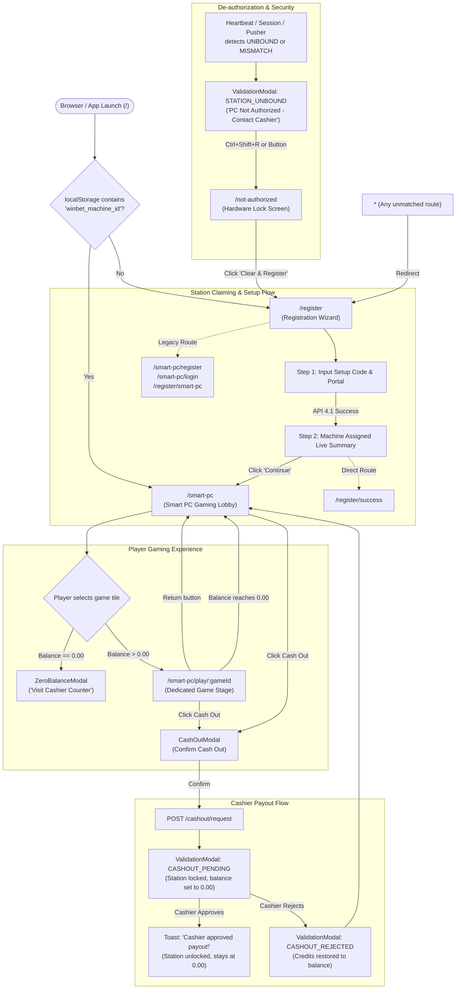

# Page Flows & Routes — Betwise Smart PC

**Document Scope:** Complete routing architecture, page lifecycle, modal dialogs, and user flow states  
**Routing Library:** `react-router-dom` v7 (`7.18.4`) with React 19 `Suspense` & dynamic `lazy()` imports  
**Root Router File:** `src/routes/AppRoutes.tsx`  

---

## 1. Route Table & Navigation Manifest

The application enforces strict navigation branching based on whether the physical station has been claimed and registered on the server:



### 1.1 Complete Route Specification

| Route Path | Associated Component | Lazy Loaded? | Guard / Condition | Purpose & Description |
| :--- | :--- | :--- | :--- | :--- |
| `/` | `<Navigate to={...} replace />` | No | `hasRegisteredMachine ? "/smart-pc" : "/register"` | Root entry redirect. If station is already registered, goes directly to lobby; otherwise goes to registration. |
| `/register` | `Registration` | Yes | None | Primary machine registration page. Form takes Portal slug and Setup Code. |
| `/smart-pc/register` | `Registration` | Yes | None | Alias route mapping to Registration component. |
| `/smart-pc/login` | `Registration` | Yes | None | Alias route mapping to Registration component. |
| `/register/smart-pc` | `Registration` | Yes | None | Alias route mapping to Registration component. |
| `/register/success` | `RegistrationSuccess` | Yes | None | Dedicated post-registration confirmation view displaying live machine identity, shop name, and location. |
| `/smart-pc` | `SmartPCLobby` | Yes | Reads `localStorage` | Primary gaming station lobby. Contains live winners ticker, hero banner, category filters, game catalog, and bottom dock. |
| `/smart-pc/play/:gameId` | `GamePlayPage` | Yes | Balance $> 0.00$ (Auto-redirects to lobby if balance is 0.00) | Fullscreen dedicated game stage. Displays live provider iframe or local Fast Bet arcade engine. |
| `/smart-pc/play` | `GamePlayPage` | Yes | Balance $> 0.00$ | Param-less game stage route; defaults to Aviator if no game ID is specified. |
| `/play/:gameId` | `GamePlayPage` | Yes | Balance $> 0.00$ | Convenience alias route for game playback. |
| `/smart-pc/cashout` | `SmartPCCashOut` | Yes | Reads `localStorage` | Direct cash-out confirmation page route (opens `CashOutModal` over lobby layout). |
| `/not-authorized` | `NotAuthorized` | Yes | None | Screen 28 hardware lock page shown when station fingerprint mismatches or slot is unbound on server. |
| `*` | `<Navigate to="/register" replace />` | No | Catch-all | Fallback redirect for any unrecognized URL path. |

---

## 2. Detailed Screen Breakdown

### Screen 1: Registration (`src/pages/Registration/Registration.tsx`)
*   **Target URL:** `/register`
*   **Page Type:** Two-step interactive setup wizard.
*   **Step 1 — Registration Setup Form:**
    *   **Inputs:** `PORTAL` (text input, defaults to `"betwise"`) and `SETUP CODE` (monospace text input, e.g. `WB-SHOP-4821` / `DEMO2026`).
    *   **Quick Lobby Access:** If `winbet_machine_id` is already stored, renders a **"Lobby"** shortcut button allowing staff to bypass registration.
    *   **Device Fingerprint Generation:** Generates a unique client fingerprint `fp_spc_{random12}` via `api.generateNewDeviceFingerprint()`.
    *   **Submission Action:** Calls `api.registerSmartPC()`. On error, displays a structured red alert box. If error contains `"already registered"`, provides a **"Reset Device ID & Register Now"** button to generate a fresh fingerprint.
*   **Step 2 — Registration Successful (Inline Step):**
    *   Renders glowing emerald green checkmark animation.
    *   Displays server-returned parameters: Machine Name (`pc_name` or `machine_id`), Machine Code, Shop Name, Portal, and Setup Code.
    *   **Action Button:** **"Continue to Platform →"**, routes user directly to `/smart-pc`.

### Screen 2: Registration Success (`src/pages/RegistrationSuccess/RegistrationSuccess.tsx`)
*   **Target URL:** `/register/success`
*   **Purpose:** Dedicated standalone confirmation view matching Section 4.1 specifications.
*   **Elements:** Brand logo header, confirmation summary receipt card (Machine Name, Type, Shop Name, Location, Setup Code), and primary button **"CONTINUE TO GAMING PLATFORM"**.

### Screen 3: Smart PC Lobby (`src/pages/SmartPC/SmartPCLobby.tsx`)
*   **Target URL:** `/smart-pc`
*   **Layout:** Wrapped in `GamingLayout` with sticky top header (`GamingHeader`) and sticky bottom dock.
*   **Visual Hierarchy:**
    1.  **Header:** Betwise brand mark, machine status chip (`ONLINE`), machine name (`Smart PC-03`), shop name, live balance chip, and **"Cash Out"** gold button.
    2.  **Hero Showcase Banner (`SmartPCHeroBanner.tsx`):** Autoplay swiper slider cycling promotional artwork (`/assets/banner/1.png`, `2.png`, `3.png`) with crossfade effect.
    3.  **Live Winners Feed (`LiveWinnersTicker.tsx`):** Real-time horizontal ticker generating simulated recent player wins (e.g., `Player #7043 won N$ 5,274.00 on Aviator`).
    4.  **Category Navigation Bar:** Strictly 3 category tabs:
        *   `ALL GAMES` (Shows entire catalog with count)
        *   `SPRIBE` (Filters to Spribe instant games)
        *   `PROVIDER` (Reveals chamfered sub-pills for external providers like Barbara Bang, Evolution, Wazdan, etc.)
    5.  **Search Input:** Real-time filter by game title, provider, or category tags.
    6.  **Game Grid (`GameGrid.tsx`):** Responsive grid of `GameCard` components with 3D tilt micro-animations, loading shimmer skeletons, and multi-tier image fallback.
    7.  **Pagination Loader:** Progress bar displaying games loaded out of total (e.g., "Showing 50 of 320 Live Games") with **"View More Games (+50)"** button.
    8.  **Featured & Popular Swipers:** Horizontal carousels showcasing top-tier provider games.
    9.  **Help Banner (`SmartPCHelpBar.tsx`):** Assistance callout instructing players to visit cashier desk for top-ups.
    10. **Bottom Dock:** Shop location on the left, primary action button **"Cash Out"** on the right.

### Screen 4: Dedicated Game Stage (`src/pages/SmartPC/GamePlayPage.tsx`)
*   **Target URL:** `/smart-pc/play/:gameId`
*   **Header Bar:** Retains identical gaming header from the lobby (Lobby back button, station badge, live balance, cash-out button, sound toggle, fullscreen toggle, popout window button).
*   **Dual Mode Engine:**
    *   **Mode 1 — Live Provider Stream (`stream`):** Invokes `api.launchProviderGame(gameId)`. If backend returns an authenticated external URL, mounts an embedded `<iframe allow="autoplay; fullscreen; clipboard-write">`. If the provider stream fails or returns a staging redirect, displays a **"Game Launch Failed"** dialog with options to **Retry**, **Return to Lobby**, or switch to **Play Fast Bet**.
    *   **Mode 2 — Fast Bet Arcade Engine (`arcade`):** Built-in interactive betting interface. Supports animated 3-reel slot machines (for slot categories) or binary prediction selectors (RED/BLACK, HEADS/TAILS, HI/LO, etc.) executing live bets against `api.placeBet()`.
*   **Zero-Balance Guard:** If balance drops to `0.00`, the page automatically navigates back to `/smart-pc` to prevent orphaned game sessions.

### Screen 5: Cash Out Route (`src/pages/SmartPC/SmartPCCashOut.tsx`)
*   **Target URL:** `/smart-pc/cashout`
*   **Purpose:** Dedicated direct route that mounts the lobby background while automatically triggering `CashOutModal` if balance $> 0.00$, or `ZeroBalanceModal` if balance $== 0.00$.

### Screen 6: Hardware Not Authorized (`src/pages/NotAuthorized/NotAuthorized.tsx`)
*   **Target URL:** `/not-authorized`
*   **Purpose:** Screen 28 security lock state triggered when server returns `UNBOUND`, `MISMATCH`, or `DEAUTHORIZED`.
*   **Elements:** Glowing crimson alert emblem, "PC Not Authorized" headline, machine ID details box, and a single prominent action button: **"CLEAR LOCAL DATA & REGISTER AGAIN"**. Clears all tokens, generates a new fingerprint, and redirects to `/register`.

---

## 3. Modal Dialogs & Transition States

All modal interactions are rendered using high-z-index accessible modals with backdrop blur:

```
┌─────────────────────────────────────────────────────────────────────────────┐
│                            ACTIVE MODAL SYSTEM                              │
├─────────────────────────┬──────────────────────────┬────────────────────────┤
│ Modal Component         │ Trigger Condition        │ Player / Staff Actions │
├─────────────────────────┼──────────────────────────┼────────────────────────┤
│ CashOutModal            │ Click "Cash Out" button  │ • Confirm Cash Out     │
│ (Step 4 Confirmation)   │ when balance > 0.00      │ • Cancel               │
├─────────────────────────┼──────────────────────────┼────────────────────────┤
│ ZeroBalanceModal        │ Click game tile or       │ • "Understood, Visit   │
│ (Station Balance Alert) │ "Cash Out" when bal == 0 │   Cashier Desk"        │
├─────────────────────────┼──────────────────────────┼────────────────────────┤
│ ValidationModals:       │ Player confirms Cash Out;│ • Locked modal         │
│ CASHOUT_PENDING         │ server returns PENDING   │ • Awaits cashier approval│
├─────────────────────────┼──────────────────────────┼────────────────────────┤
│ ValidationModals:       │ Cashier declines payout  │ • "Back to Games"      │
│ CASHOUT_REJECTED        │ in back office           │   (Credits restored)   │
├─────────────────────────┼──────────────────────────┼────────────────────────┤
│ ValidationModals:       │ Server returns UNBOUND,  │ • "Register New Token" │
│ STATION_UNBOUND         │ MISMATCH, or DEAUTH      │ • Ctrl+Shift+R         │
├─────────────────────────┼──────────────────────────┼────────────────────────┤
│ ValidationModals:       │ Backend shop credit is   │ • "Understood"         │
│ SHOP_BALANCE_TOO_LOW    │ lower than requested amt │                        │
├─────────────────────────┼──────────────────────────┼────────────────────────┤
│ ThemeNotificationModal  │ Toast events (credits    │ • Auto-dismisses (3.5s)│
│ (Toast overlay)         │ loaded, admin unlock)    │ • Close 'X' button     │
└─────────────────────────┴──────────────────────────┴────────────────────────┘
```
