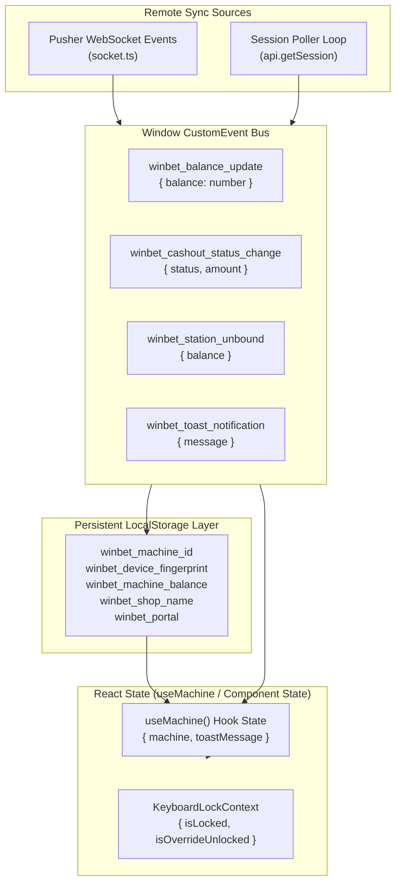

# State Management & Data Contracts — Betwise Smart PC

**Document Scope:** Client-side state architecture, LocalStorage schemas, custom event bus specifications, and TypeScript data contracts.  
**Primary Files:** `src/types/index.ts`, `src/hooks/useMachine.ts`, `src/constants/machine.ts`, `src/utils/formatCurrency.ts`  

---

## 1. State Architecture Overview

State management in Betwise Smart PC is engineered to survive page reloads, temporary network dropouts, and multi-tab scenarios without relying on heavyweight external state libraries (e.g. Redux).

The architecture is composed of four cooperating mechanisms:

1.  **Browser `localStorage`:** Acts as the persistent ground truth for hardware binding, tokens, station identity, and active balance.
2.  **Custom Window Event Bus:** Asynchronous pub/sub event layer on the browser `window` object for zero-latency cross-component communication.
3.  **Storage Event Listener:** Detects mutations across tabs or iframe parent windows via `window.addEventListener("storage", ...)`.
4.  **Shared Singleton Session Poller (`runSessionTracker`):** Continuously validates local state against the remote REST server every 2.5 seconds.



---

## 2. LocalStorage Key Schema

All persistent keys are prefixed with `winbet_` to prevent namespace collisions:

| Key Name | Type | Example Value | Description |
| :--- | :--- | :--- | :--- |
| `winbet_machine_id` | `string` | `"SPC-03"` | Primary hardware identifier assigned by server upon registration. |
| `winbet_numeric_id` | `string` | `"142"` | Database primary key ID of the machine record. |
| `winbet_machine_name` | `string` | `"Smart PC-03"` | Display label shown in header and dock. |
| `winbet_machine_type` | `"smart-pc" \| "terminal"` | `"smart-pc"` | Machine profile variant. |
| `winbet_machine_balance` | `string` | `"250.00"` | Active player chip balance. |
| `winbet_setup_code` | `string` | `"WB-SHOP-4821"` | The shop setup code used to claim this station. |
| `winbet_registration_token`| `string` | `"WB-SHOP-4821"` | Normalized uppercase registration token. |
| `winbet_shop_id` | `string` | `"8"` | Numerical shop ID assigned on server. |
| `winbet_shop_name` | `string` | `"Windhoek Central"` | Physical shop name. |
| `winbet_shop_location` | `string` | `"Independence Ave"` | Physical street or location. |
| `winbet_player_id` | `string` | `"11045"` | Virtual player ID allocated by server for this session. |
| `winbet_portal` | `string` | `"betwise"` | Tenant operator portal slug. |
| `winbet_device_fingerprint`| `string` | `"fp_spc_9f82ab410d12"`| Unique hardware device fingerprint. |

---

## 3. Window CustomEvent Bus Specifications

Exported from `src/hooks/useMachine.ts`:

### 3.1 `winbet_balance_update`
*   **Constant:** `BALANCE_EVENT = "winbet_balance_update"`
*   **Broadcaster:** `broadcastBalanceChange(newBalance: number)`
*   **Detail Schema:**
    ```typescript
    interface BalanceEventDetail {
      balance: number; // Sanitized, non-negative number
    }
    ```
*   **Behavior:** Writes `newBalance` to `localStorage.winbet_machine_balance` and dispatches `CustomEvent`.

### 3.2 `winbet_cashout_status_change`
*   **Constant:** `CASHOUT_STATUS_EVENT = "winbet_cashout_status_change"`
*   **Broadcaster:** `broadcastCashoutStatusChange(status, amount)`
*   **Detail Schema:**
    ```typescript
    interface CashoutStatusEventDetail {
      status: "PENDING" | "APPROVED" | "REJECTED" | "NONE";
      amount: number;
    }
    ```

### 3.3 `winbet_station_unbound`
*   **Constant:** `STATION_UNBOUND_EVENT = "winbet_station_unbound"`
*   **Broadcaster:** `broadcastStationUnbound(balance?: number)`
*   **Detail Schema:**
    ```typescript
    interface StationUnboundEventDetail {
      balance?: number;
    }
    ```
*   **Behavior:** Triggers `ValidationModals: STATION_UNBOUND` and halts input.

### 3.4 `winbet_toast_notification`
*   **Constant:** `TOAST_EVENT = "winbet_toast_notification"`
*   **Broadcaster:** `broadcastToast(message: string)`
*   **Detail Schema:**
    ```typescript
    interface ToastEventDetail {
      message: string;
    }
    ```

---

## 4. TypeScript Canonical Data Contracts

Extracted directly from `src/types/index.ts`:

### 4.1 Machine & Shop Models
```typescript
export type MachineType = "smart-pc" | "terminal";

export interface Machine {
  name: string;
  type: MachineType;
  balance: number;
  shopName: string;
  location: string;
  action: string;
}

export interface ShopInfo {
  name: string;
  location: string;
  tagline?: string;
}

export interface TicketInfo {
  ticketNumber: string;
  amount: number;
  createdAt: string;
  machineName: string;
  shopName: string;
}
```

### 4.2 Validation Alert Union Type
```typescript
export type ValidationAlertType =
  | "NONE"
  | "SHOP_BALANCE_TOO_LOW"
  | "PRINTER_FAILED"
  | "NOTE_NOT_ACCEPTED"
  | "SCAN_AGAIN"
  | "TICKET_NOT_ACCEPTED"
  | "PRINTER_REQUIRED"
  | "CASHOUT_PENDING"
  | "CASHOUT_REJECTED"
  | "CASHOUT_APPROVED"
  | "CHIPS_LOADED"
  | "STATION_UNBOUND";
```

### 4.3 REST API Contracts (Section 4 PDF Standards)
```typescript
// 4.1 Register Payload
export interface SmartPCRegisterPayload {
  portal_slug: string;
  registration_token: string;
  device_fingerprint: string;
  operating_system?: string;
}

// 4.1 Register Return Data
export interface SmartPCRegisterData {
  id: number;
  machine_id: string;
  hostname?: string;
  terminal_name?: string;
  pc_name?: string;
  shop_id: number;
  shop_name: string;
  status: string;
  current_balance: number;
  player_id: number;
}

// 4.3 Session Return Data
export interface SmartPCSessionData {
  id: number;
  machine_id: string;
  hostname?: string;
  terminal_name?: string;
  pc_name?: string;
  status: string;
  current_balance: number;
  loaded_amount: number;
  player_id: number;
  shop_id: number;
  shop_name: string;
  pending_cash_out: null | {
    id: number;
    requested_amount: number;
    status: string;
    requested_at?: string;
  };
}

// 4.5 Game Catalog Contract
export interface SmartPCGameItem {
  id: string | number;
  uuid?: string;
  name: string;
  category: string;
  description?: string;
  payout_label?: string;
  choices?: string[];
  kind: "provider" | "local";
  provider: string;
  image?: string | null;
  provider_image?: string | null;
  launcher?: string;
}

export interface SmartPCGamesPageResponse {
  games: SmartPCGameItem[];
  currentPage: number;
  lastPage: number;
  total: number;
  hasMore: boolean;
}

// 4.6 Launch Game Token Contract
export interface SmartPCLaunchGameResponse {
  game_url: string;
  game_name: string;
  provider: string;
  game_id: string | number;
  player_id: number;
}

// 4.7 Place Bet Contract
export interface SmartPCPlaceBetResponse {
  game: string;
  game_name: string;
  choice: string;
  result: string;
  won: boolean;
  stake: number;
  payout: number;
  multiplier: number;
  current_balance: number;
  message: string;
  round_id?: string;
  transaction_id?: number;
  player_id: number;
}

// 4.8 Cash-out Contract
export interface SmartPCCashoutData {
  id: number;
  machine_id: string;
  shop_machine_id?: number;
  pc_name?: string;
  shop_id: number;
  shop_name: string;
  player_id: number;
  requested_amount: number;
  approved_amount?: number | null;
  remarks?: string | null;
  status: "PENDING" | "APPROVED" | "REJECTED";
  requested_at: string;
  processed_at?: string | null;
}
```

---

## 5. Currency & Ticket Utilities (`src/utils/formatCurrency.ts`)

```typescript
// Namibian Dollar Formatting
export const formatCurrency = (amount: number): string => {
  return `N$ ${amount.toFixed(2)}`;
};

// Generates Mock Ticket Number: e.g. "TKT-88421"
export const generateTicketNumber = (): string => {
  const num = Math.floor(88000 + Math.random() * 999);
  return `TKT-${num}`;
};
```
