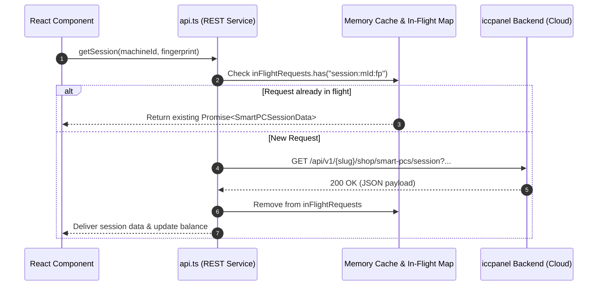

# System Architecture — Betwise Smart PC

**Document Scope:** Full architectural analysis of the Betwise Smart PC kiosk client  
**Runtime:** Tauri v2 (`2.12.1`) Desktop Runtime (Linux / Windows)  
**Frontend Engine:** React 19 (`19.2.8`) + TypeScript + Vite 8  
**Backend Ecosystem:** `iccpanel` Shop API (`https://staging.iccpanel.com/api/v1/{portal_slug}/shop`) + Pusher WebSocket Cluster  

---

## 1. High-Level Architectural Diagram

The system operates as a hybrid native-web application. A high-performance Rust core runs the native desktop host and hooks into operating system APIs, while an isolated WebView renders the React 19 Single Page Application (SPA).

```mermaid
graph TB
    subgraph Host_Operating_System["Host Operating System (Windows / Linux)"]
        KBD_HOOK["Win32 Low-Level Keyboard Hook\n(WH_KEYBOARD_LL in kiosk.rs)\nBlocks: LWIN, RWIN, Alt+Tab, Alt+Esc, Ctrl+Esc"]
        DISPLAY["Display Manager\n(1920x1080 Fullscreen / Frameless Window)"]
        CACHE_DIR["Cache & Storage Directory\n(~/.cache/com.betwise.smartpc\n%LOCALAPPDATA%\\com.betwise.smartpc)"]
    end

    subgraph Native_Tauri_Core["Tauri v2 Core Process (Rust 2024 / app_lib)"]
        LIB["lib.rs / Builder Entry"]
        CMD_ROUTER["Tauri Invoke Handler\n(commands::*)"]
        SYS_SVC["SystemService\n(Hostname, OS, Arch, Version)"]
        HW_SVC["HardwareService\n(Printer Status, Native Printing Dispatch)"]
    end

    subgraph WebView_Frontend["WebView Layer (Chromium / WebKitGTK)"]
        REACT_APP["React 19 Application (App.tsx)"]
        ROUTER["React Router v7 (AppRoutes.tsx)"]
        KEY_GUARD["KeyboardLockProvider & W3C Lock\n(useKioskKeyboardLock.tsx)"]
        MACHINE_HOOK["useMachine Hook\n(Station State & Polling Loop)"]
        REST_CLIENT["api.ts REST Client\n(In-flight Deduplication & Cache)"]
        SOCKET_MGR["socket.ts Pusher Client\n(Live WebSocket Subscription)"]
        STORAGE["Browser LocalStorage\n(Machine Tokens, Fingerprint, Balance)"]
    end

    subgraph External_Cloud_Services["Remote Cloud Services (iccpanel Staging)"]
        ICC_REST["Shop REST API\n(/api/v1/{portal_slug}/shop/*)"]
        PUSHER_SERVER["Pusher / Laravel Echo Server\n(private-smart-pc.{id})"]
        GAME_SERVERS["External Game Providers\n(Spribe, Pragmatic, Slotegrator Iframe)"]
    end

    DISPLAY --> WebView_Frontend
    KBD_HOOK -.->|Suppresses System Hotkeys| Host_Operating_System

    REACT_APP --> ROUTER
    REACT_APP --> KEY_GUARD
    REACT_APP --> MACHINE_HOOK

    MACHINE_HOOK --> REST_CLIENT
    MACHINE_HOOK --> SOCKET_MGR
    MACHINE_HOOK <--> STORAGE

    REST_CLIENT -->|IPC invoke()| CMD_ROUTER
    CMD_ROUTER --> SYS_SVC
    CMD_ROUTER --> HW_SVC

    REST_CLIENT <-->|HTTPS POST/GET JSON| ICC_REST
    SOCKET_MGR <-->|WSS Encrypted Socket| PUSHER_SERVER
    ROUTER -->|Iframe / Popout Window| GAME_SERVERS
```

---

## 2. Process Model & Execution Layers

The application is structured into two isolated processes communicating via Tauri's asynchronous IPC bridge:

### 2.1 The Native Core Process (Rust)
*   **Entry Points:** `src-tauri/src/main.rs` and `src-tauri/src/lib.rs`.
*   **Compilation Targets:** Linux Debian (`.deb`) and Windows NSIS executable (`.exe`).
*   **Responsibilities:**
    *   Initialize low-level system keyboard hooks before window creation (`kiosk::init()`).
    *   Instantiate the Tauri application window in borderless, non-resizable fullscreen mode (`1920x1080` default, minimum `1024x768`).
    *   Expose safe native IPC commands to the web layer without allowing arbitrary shell access.
    *   Collect system telemetry (hostname, operating system family, CPU architecture).
    *   Manage native ESC/POS thermal printing logging and dispatch.

### 2.2 The Frontend Renderer Process (WebView)
*   **Engines:** WebKitGTK 4.1 on Linux; Microsoft Edge WebView2 on Windows.
*   **Framework:** React 19.2.8 with TypeScript and Vite 8.
*   **Responsibilities:**
    *   Render the customer-facing gaming interface, live winner ticker, hero banners, and game grid.
    *   Handle game streaming through embedded iframes and secondary popout windows.
    *   Maintain active session polling (2.5s interval) and periodic station heartbeats (10s interval).
    *   Intercept all DOM-level keyboard and mouse events to enforce zero-balance kiosk locks.
    *   Manage registration and station claim lifecycles.

---

## 3. Native Layer & Tauri IPC Specifications

Tauri exposes four native commands via `tauri::generate_handler!`:

```rust
// src-tauri/src/lib.rs:18-23
.invoke_handler(tauri::generate_handler![
    get_machine_information,
    get_hardware_status,
    print_ticket_native,
    get_system_time
])
```

### 3.1 Command Manifest

| Command Name | Rust Handler File | TypeScript Invocation | Return Type | Description |
| :--- | :--- | :--- | :--- | :--- |
| `get_machine_information` | `commands/mod.rs:5` | `getNativeMachineInfo()` in `services/tauri.ts` | `NativeMachineInfo` | Queries hostname, OS platform, CPU architecture, app version (`1.0.2`), and kiosk flag (`true`). |
| `get_hardware_status` | `commands/mod.rs:10` | `getNativeHardwareStatus()` in `services/tauri.ts` | `NativeHardwareStatus` | Queries simulated/connected peripherals: printer status, scanner status, bill acceptor status. |
| `print_ticket_native` | `commands/mod.rs:15` | `printTicketNative(payload)` in `services/tauri.ts` | `NativePrintTicketResponse` | Dispatches ESC/POS ticket printing payload to system printer with validation (blocks $\le 0.00$ amounts). |
| `get_system_time` | `commands/mod.rs:20` | `invoke("get_system_time")` | `String` (Unix Timestamp) | Returns system clock in seconds since Unix epoch to detect local time tampering. |

### 3.2 System Data Contracts (Rust & TS)

```rust
// src-tauri/src/services/mod.rs
#[derive(Debug, Clone, Serialize, Deserialize)]
pub struct MachineInfo {
    pub os: String,            // e.g. "Linux (linux)"
    pub hostname: String,      // HOSTNAME or HOST env var, fallback "smart-pc-linux"
    pub platform: String,      // "linux" or "windows"
    pub arch: String,          // e.g. "x86_64"
    pub app_version: String,   // env!("CARGO_PKG_VERSION") = "1.0.2"
    pub is_kiosk: bool,        // true
}

// src-tauri/src/hardware/mod.rs
#[derive(Debug, Clone, Serialize, Deserialize)]
pub struct HardwareStatus {
    pub printer_connected: bool,        // true
    pub printer_name: String,           // "Generic ESC/POS Thermal Printer (Simulated/Auto)"
    pub scanner_connected: bool,        // true
    pub bill_acceptor_connected: bool,  // false (Smart PC does not possess a bill acceptor)
    pub status_message: String,
}

#[derive(Debug, Clone, Serialize, Deserialize)]
pub struct PrintTicketPayload {
    pub ticket_number: String,
    pub amount: f64,
    pub machine_name: String,
    pub shop_name: String,
    pub created_at: String,
    pub barcode: Option<String>,
}
```

---

## 4. Hardware Security & Kiosk Lock Subsystem

The application uses a multi-layered defense to prevent players from bypassing the kiosk environment or accessing the operating system desktop:

```
┌───────────────────────────────────────────────────────────────────┐
│                       KIOSK SECURITY LAYERS                       │
├───────────────────────────────────────────────────────────────────┤
│ Layer 1: OS-Level Low-Level Keyboard Hook (src-tauri/kiosk.rs)    │
│  - Intercepts WH_KEYBOARD_LL at the Win32 subsystem level         │
│  - Drops VK_LWIN (0x5B) and VK_RWIN (0x5C)                        │
│  - Drops Alt + Tab (VK_TAB + LLKHF_ALTDOWN)                       │
│  - Drops Alt + Escape (VK_ESCAPE + LLKHF_ALTDOWN)                 │
│  - Drops Ctrl + Escape (VK_ESCAPE + GetAsyncKeyState(VK_CONTROL)) │
├───────────────────────────────────────────────────────────────────┤
│ Layer 2: W3C Keyboard Lock API (src/hooks/useKioskKeyboardLock.tsx)│
│  - Calls navigator.keyboard.lock(["MetaLeft", "MetaRight", "Escape"])│
│  - Blocks browser-level fullscreen escape gestures                │
├───────────────────────────────────────────────────────────────────┤
│ Layer 3: Application Zero-Balance Input Guard                     │
│  - When balance == 0.00: intercepts keydown, keyup, keypress,     │
│    and contextmenu events in capture phase (true)                 │
│  - Prevents game input until cashier loads credit or admin unlocks│
├───────────────────────────────────────────────────────────────────┤
│ Layer 4: Authorized Staff Shortcut Combos                         │
│  - Ctrl + Shift + D / K : Toggles keyboard lock override          │
│  - Ctrl + Shift + R     : Unbinds machine & clears tokens         │
└───────────────────────────────────────────────────────────────────┘
```

---

## 5. Network Request Lifecycle & Deduplication Architecture

To protect both the staging server and client memory from request flooding (frequent polling, concurrent UI updates, and tab re-focusing), `src/services/api.ts` implements in-flight promise deduplication and time-to-live (TTL) in-memory query caching.



### 5.1 Caching Profiles

| Endpoint Category | Method / Path | In-Flight Deduplication | Cache TTL | Invalidation Trigger |
| :--- | :--- | :--- | :--- | :--- |
| **Session** | `GET /smart-pcs/session` | Yes (`session:{id}:{fp}`) | 0s (Always fresh, deduplicated) | On new request cycle or unbind |
| **Providers** | `GET /smart-pcs/providers` | Yes (`providers:{search}:{page}:{limit}`) | 60,000 ms (60 seconds) | `api.clearCache()` or Registration |
| **Games Catalog** | `GET /smart-pcs/games` | Yes (`games:{provider}:{page}:{limit}`) | 30,000 ms (30 seconds) | `api.clearCache()` or Registration |
| **Registration** | `POST /smart-pcs/register` | No | None (Bypasses cache) | Clears all caches via `clearApiCache()` |
| **Heartbeat** | `POST /smart-pcs/heartbeat` | No | None | Scheduled background timer (10s) |
| **Cash-Out Request** | `POST /cashout/request` | No | None | Immediate state mutation to 0.00 |

---

## 6. Directory Layout & Module Ownership

```
├── src/
│   ├── App.tsx                     # Top-level application shell, mounts KeyboardLockProvider & liveSocket
│   ├── main.tsx                    # ReactDOM bootstrap, loads Bootstrap 5 & FontAwesome 7
│   ├── routes/
│   │   └── AppRoutes.tsx           # Route table, route-level code splitting via React.lazy
│   ├── services/
│   │   ├── api.ts                  # REST API client, URL builders, in-flight caching, fallback balances
│   │   ├── socket.ts               # Pusher client singleton, private channel subscriptions, unbind events
│   │   └── tauri.ts                # Tauri invoke() wrappers with browser environment guards
│   ├── hooks/
│   │   ├── useMachine.ts           # Central station hook, singleton session tracker (2.5s), event broadcasters
│   │   └── useKioskKeyboardLock.tsx# Kiosk input interceptor, shortcut handler (Ctrl+Shift+D/R), notification
│   ├── pages/
│   │   ├── Registration/           # Registration wizard (Step 1: Setup Code, Step 2: Confirmation)
│   │   ├── RegistrationSuccess/    # Post-registration summary screen with machine metadata
│   │   ├── NotAuthorized/          # Station de-authorization screen (Screen 28), clear tokens & rebind
│   │   └── SmartPC/
│   │       ├── SmartPCLobby.tsx    # Primary station lobby: hero banner, game catalog, cash-out modal
│   │       ├── GamePlayPage.tsx    # Dedicated game stage: provider stream iframe or Fast Bet arcade
│   │       └── SmartPCCashOut.tsx  # Direct cash-out confirmation page route
│   ├── components/
│   │   ├── layout/                 # GamingHeader, GamingLayout, ShopLocation
│   │   ├── gaming/                 # GameGrid, GameCard, ValidationModals, LiveWinnersTicker, Banner
│   │   └── common/                 # Modal, Toast, Button, Loading, ThemeNotificationModal
│   ├── constants/
│   │   └── machine.ts              # Default fallback games, shop info, and machine configurations
│   ├── types/
│   │   └── index.ts                # TypeScript interfaces and validation alert types
│   └── styles/
│       ├── theme.css               # Design system tokens (colors, gradients, chamfer radii)
│       ├── global.css              # Global styles, button utilities, animations, card styles
│       └── responsive.css          # Breakpoint overrides for POS kiosks and touchscreen displays
└── src-tauri/
    ├── Cargo.toml                  # Rust package manifest (tauri 2.12.1, serde, log)
    ├── tauri.conf.json             # Tauri configuration (window sizing, permissions, bundle targets)
    ├── build.rs                    # Tauri build-time hook
    ├── installer_hooks.nsh         # NSIS pre-install / post-uninstall hooks (process termination, cache wipe)
    ├── capabilities/
    │   └── default.json            # Tauri v2 security capability granting core permissions
    ├── scripts/
    │   ├── deb-preinstall.sh       # Debian pre-install script: terminates running smartpc processes
    │   ├── deb-postinstall.sh      # Debian post-install script: wipes old user cache directories
    │   └── deb-postremove.sh       # Debian post-remove script: cleans leftover user cache on purge
    └── src/
        ├── main.rs                 # Native process entry point
        ├── lib.rs                  # Application builder, logger init, command registration
        ├── kiosk.rs                # Windows low-level keyboard hook implementation
        ├── commands/mod.rs          # Native command definitions callable from TypeScript
        ├── hardware/mod.rs         # Simulated hardware status & thermal ticket print logger
        └── services/mod.rs         # System OS and hostname resolution service
```
