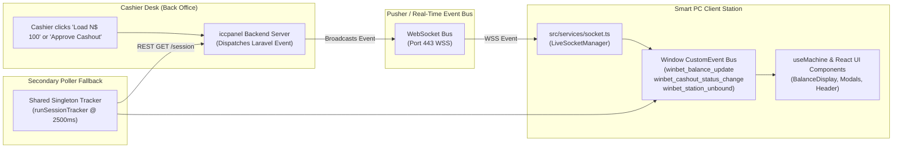

# WebSocket & Real-Time Events — Betwise Smart PC

**Document Scope:** Full specification of the real-time event pipeline, WebSocket subscriptions, event payload contracts, channel authentication, and dual-layer polling fallback.  
**Source Files:** `src/services/socket.ts` & `src/hooks/useMachine.ts`  
**WebSocket Driver:** `pusher-js` (`^8.6.0`)  
**Host Architecture:** Laravel Echo / Pusher Protocol Server  

---

## 1. Real-Time Pipeline Overview

Physical Smart PC stations operate without direct user login sessions. When a shop cashier loads credits, confirms a cash-out, or changes a station's assignment in the back-office, the station must reflect the change **instantaneously** with zero manual page refreshing:



---

## 2. WebSocket Configuration & Initialization

Configuration parameters are resolved at runtime in `src/services/socket.ts`:

| Configuration Key | Environment Variable | Source Code Default | Description |
| :--- | :--- | :--- | :--- |
| **App Key** | `VITE_PUSHER_APP_KEY` | `"staging_iccpanel_key"` | The public Pusher application key. |
| **Host** | `VITE_PUSHER_HOST` | `"staging.iccpanel.com"` | Custom domain running the WebSocket daemon. |
| **Port** | `VITE_PUSHER_PORT` | `443` | WebSocket port. Client uses `wssPort: 443` with `forceTLS: true`. |
| **Cluster** | `VITE_PUSHER_APP_CLUSTER` | `"mt1"` | Regional cluster identifier. |
| **Transports** | — | `["ws", "wss", "xhr_streaming", "xhr_polling"]` | Transport fallbacks for restricted corporate or firewall networks. |

### 2.1 Authorizer Flow (`api.broadcastAuth`)
Because machine channels are private (`private-*`), Pusher requires signature authorization before delivery:

```typescript
// src/services/socket.ts:49-62
authorizer: (channel) => {
  return {
    authorize: (socketId, callback) => {
      api
        .broadcastAuth(channel.name, socketId)
        .then((authData) => callback(null, authData))
        .catch((err) => callback(err, { auth: `auth_local_${socketId}` }));
    },
  };
}
```

The authorizer makes a `POST` request to `/broadcasting/auth/terminal` sending:
*   `channel_name`: string
*   `socket_id`: string
*   `machine_id`: string
*   `device_fingerprint`: string

---

## 3. Subscribed Channels

Upon successful initialization (`liveSocket.init()`), the client subscribes to three channel permutations to ensure broad backend compatibility:

1.  **Primary Private Channel:** `private-smart-pc.{machineId}`
2.  **Public Channel Variant:** `smart-pc.{machineId}`
3.  **Generic Machine Channel:** `private-machine.{machineId}`

*(Where `{machineId}` is the string machine ID, e.g. `SPC-03` or `Smart PC-03`).*

---

## 4. Complete Event Registry & Handlers

The client binds to multiple casing conventions for every business event:

### 4.1 Balance Updated Events

```typescript
// Subscribed event aliases:
"balance.updated"
"BalanceUpdated"
"balance_updated"
"App\\Events\\BalanceUpdated"
```

*   **Expected Server Payload:**
    ```json
    {
      "current_balance": 250.00,
      "loaded_amount": 100.00
    }
    ```
    *(Handler accepts either `current_balance`, `balance`, or `amount`).*
*   **Client Handler Action:** Invokes `broadcastBalanceChange(newBalance)`. Updates `localStorage.winbet_machine_balance`, emits `winbet_balance_update`, updates header display and dock.

---

### 4.2 Cash-Out Approved Events

```typescript
// Subscribed event aliases:
"cashout.approved"
"CashoutApproved"
"cash_out_approved"
"App\\Events\\CashoutApproved"
```

*   **Expected Server Payload:**
    ```json
    {
      "status": "APPROVED",
      "requested_amount": 150.00
    }
    ```
*   **Client Handler Action:**
    1.  Invokes `broadcastCashoutStatusChange("APPROVED", amount)`.
    2.  Invokes `broadcastBalanceChange(0)`.
    3.  Dismisses `CASHOUT_PENDING` modal.
    4.  Displays green notification toast: *"Cashier approved payout of N$ 150.00!"*.

---

### 4.3 Cash-Out Rejected Events

```typescript
// Subscribed event aliases:
"cashout.rejected"
"CashoutRejected"
"cash_out_rejected"
"App\\Events\\CashoutRejected"
```

*   **Expected Server Payload:**
    ```json
    {
      "status": "REJECTED",
      "restored_amount": 150.00
    }
    ```
*   **Client Handler Action:**
    1.  Invokes `broadcastCashoutStatusChange("REJECTED", amount)`.
    2.  Restores funds to station balance via `broadcastBalanceChange(restored_amount)`.
    3.  Opens `ValidationModals: CASHOUT_REJECTED` (Screen 06 Credits Restored).
    4.  Shows toast: *"Cashier rejected cash out. Credits restored to machine."*.

---

### 4.4 Station Unbound / De-authorized Events

To support remote fleet management, if an operator unbinds, deactivates, or reassigns a Smart PC in the Back Office, the server broadcasts an unbind event. The client listens to 21 distinct event names:

```typescript
// src/services/socket.ts:140-162
const unbindEventNames = [
  "machine.unbound",
  "MachineUnbound",
  "smart-pc.unbound",
  "smart_pc.unbound",
  "station.unbound",
  "StationUnbound",
  "unbind",
  "Unbind",
  "machine.deauthorized",
  "smart-pc.deauthorized",
  "station.deauthorized",
  "deauthorized",
  "machine.deleted",
  "smart-pc.deleted",
  "station.unassigned",
  "StationUnassigned",
  "App\\Events\\MachineUnbound",
  "App\\Events\\SmartPCUnbound",
  "App\\Events\\StationUnbound",
  "App\\Events\\MachineDeauthorized",
  "App\\Events\\MachineStatusUpdated"
];
```

*   **Client Handler Action:**
    *   Logs security event to console.
    *   Invokes `broadcastStationUnbound(data.current_balance)`.
    *   Opens `ValidationModals: STATION_UNBOUND` ("PC Not Authorized - Please contact shop cashier").
    *   Disables player inputs.

---

## 5. Dual-Layer Fallback Poller (`runSessionTracker`)

Because physical shop networks may experience brief Wi-Fi or LTE drops, the application does not rely solely on WebSockets. `src/hooks/useMachine.ts` implements a **Shared Singleton Session Tracker**:

```typescript
// src/hooks/useMachine.ts:63-153
const runSessionTracker = async () => {
  const session = await api.getSession(machineId, fingerprint);
  // 1. Balance diff detection:
  if (liveBal !== lastTrackedBalance) {
    const diff = liveBal - lastTrackedBalance;
    broadcastBalanceChange(liveBal);
    if (diff > 0 && !session.pending_cash_out) {
      broadcastToast(`+N$ ${diff.toFixed(2)} chips loaded by cashier desk!`);
    }
  }
  // 2. Pending cashout resolution detection (Transition from PENDING to APPROVED or REJECTED)
  // 3. Station status unbind detection
};
```

*   **Polling Frequency:** Every 2,500 milliseconds (2.5 seconds).
*   **Subscriber Counter:** Increments when components mount `useMachine()`. Stops the timer when subscribers reach zero, preventing CPU and battery waste.
*   **Cashier Panel Status Cleared Handling:** If a pending cashout record disappears from the session response without an explicit status flag, the client infers resolution based on whether balance returned to zero (approved) or was restored (rejected).
